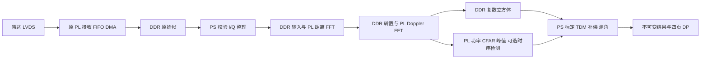

# M2 PL 计算链迁移与弱目标检测：离线交付结果

构建 `20261101_pl_dsp_01`，2026-11-01。**主要计算链已在 PL 实现，原生仿真、综合实现和匹配软件构建通过；弱目标候选算法未达到收益门槛，保持实验状态。** 本轮未操作板卡，实际吞吐、物理检测提升及优于 TI 原生输出均未证明。

唯一硬件主线为 [Radar_XCZU2CG_M2.xpr](/fpga/Radar_XCZU2CG_M2.xpr)，软件主线为 [Radar_Vitis_M2](/software)。未制作压缩包，未连接串口或 JTAG，未修改或验证 KEY3，四页显示布局保留。

## 已实现的计算与调度

PL 承担去直流、Hann 窗、256 点距离 FFT、DDR 分块转置、32 点 Doppler FFT、12 通道功率归并、二维 CFAR、3×3 峰值筛选、最强 32 点输出及可关闭的时序背景检测。两个 AMD FFT IP 均采用计划指定的 **Radix-2 Burst、24 位定点、自然序输出和非实时反压**，分别按 1/256、1/32 缩放；实际配置口宽度为 24/16 位。两块 16 距离单元缓存交替使用，本版没有宣称并行预取。

PS 保留严格 HSI/CRC 校验、I/Q 整理、采集和内存所有权、标定、TDM 补偿、测角及 DP 显示。PL 后端导入复数结果后不重复 FFT 或相位补偿。新增 `submit / poll / cancel` 和 `PS_REFERENCE / PL_BASELINE / PL_ENHANCED`；默认参考后端，身份或能力不匹配时拒绝启用 PL，不静默切换。

输入固定为 3TX×4RX、256 点、32 循环、槽位 `[0,2,1]`，输出按物理 TX/RX 排列。首页谱仍来自 384 次距离 FFT 的线性功率平均。新增 CSR 为 `0xA0020000/64 KiB`，独立工作区为 `[0x02600000,0x03600000)`；原 DMA、RAW、DP 地址保持。完整数值、寄存器、地址及错误合同见 [CONTRACT.md](CONTRACT.md)。

新增独立 DataMover；控制互连为 1SI/3MI、数据互连为 4SI/1MI。算法 ready/valid 没有直接串入 LVDS 接收流，但共享 HP0/DDR 仲裁仍可能延长采集 DMA 等待，不能由此推断实际 FIFO 永不溢出。[原生 BD 图](checks/native_integration_burst/radar_system_final.png)已按采集、计算、时钟复位区域整理。

8/16 帧有限批次使用批次号和逐帧身份，分别校验 399,360 字节及 96 条 HSI。生产调度保留一个 RAW 消费批次和一个 RX 预取批次；处理、显示独立排队，过载受控停止，显示落后只合并显示请求。这仍是有限批次重复采集，不是已实测的无限 RF 流。

**当前先收完一批，再停止、复制、校验并发布逐帧任务。** DMA 观察时间不是 RF 采样时间，也不代表已经开始计算。单任务耗时不包含整批收集、复制、排队及显示延迟；旧批次成员首次发布时可能已经过期。500 ms 仅约束时序增强额外积累等待，不能写成端到端报警延迟已小于 500 ms。

## 离线验证证据

| 项目 | 结果与范围 |
|---|---|
| 可恢复基线 | 工程外保存 4,343 文件、267,521,109 字节；[记录](baseline.json) |
| BD 与保护对象 | 原生 Validate、重复集成与保存布局一致性通过；18 个原 RTL/XDC 哈希不变；[核验](checks/native_integration_burst/repeat_final.json) |
| 控制与传输 | AXI 控制、逐帧元数据、官方 DataMover 17 项反压/异常/取消测试通过；37 个有效参数与主线匹配；[DataMover](checks/datamover/summary.json) |
| 定点模型 | 新架构 19 例矩阵通过原定 RMS 与谱误差标准；[矩阵](checks/numeric_matrix_radix2/summary.json) |
| 时序 RTL | 96 帧、1,536 cell 与整数模型状态逐位一致；[结果](checks/temporal_native.json) |
| 完整快速回归 | 生产引擎/XPM 与官方 FFT C 模型协同的 9 例通过；64 连续任务、8/16 槽回绕及真实 RAW 回放逐位通过；其适配器时延不能冒充官方 HDL 时延；[说明](checks/dsp_engine/RESULTS.md) |
| 官方 HDL 完整帧 | 当前生产引擎、官方 FFT HDL/XPM 通过；98,304 距离复数值、98,304 Doppler 复数值、8,192 RD 值、256 谱值、候选及 524,352 字节时序状态逐位一致；[汇总](checks/dsp_engine/burst_full8/summary.json)、[数值对照](checks/dsp_engine/burst_full8/results/comparison.json) |
| 综合实现 | 当前 Burst 综合、布局布线、内部时序与严重 DRC 门槛通过；[独立审核](checks/independent_finish_audit/native_signoff_review_radix2.md) |
| 工程重开 | 启用引用完整且位于工程内，综合和 bitstream 均 `NEEDS_REFRESH=0`；[状态](checks/native_reopen_burst_01/project_state.txt) |
| PS 与平台 | 11 项主机检查和必要回归通过；匹配 XSA 原生更新 BSP/FSBL、干净构建应用、内存与身份核验通过；[PS 结果](checks/ps_integration/RESULT.json)、[原生构建](checks/platform_native/matched_burst_01/result.json) |
| 启动产物绑定 | Vitis 缓存 bit/init、当前 ELF 和冻结副本与本版匹配，启动设置不变，未实际启动；[记录](checks/launch_binding_burst_01/result.json) |

正式 routed WNS **+0.641 ns**、WHS **+0.011 ns**，56,171 条网络全部路由。资源为 **33,012/47,232 LUT、33,115/94,464 FF、78/150 BRAM、56/240 DSP**。内部未约束端点与未知 CDC 类别为 0，649 个 CDC 负载端点和 8 项 bus-skew 检查通过。

异步复位、IDELAY 方法学及外部输入时序边界已逐项审核；六个输入尚缺实物支持的 input-delay。没有填零、扩大 false-path 或降低检查严重度来掩盖缺口。**内部实现通过不等于板级下载就绪。**

19 例矩阵最大归一化复数 RMS 为 `9.1585884e-6`，有效谱点最大误差 `0.0146782 dB`，保持 `1e-5/0.1 dB` 门槛。官方 HDL 完整帧独立对照 RMS 为 `9.1621352e-6`、谱误差 `0.00148662 dB`。CFAR 临界差异没有隐藏：真实归档帧 12 个候选及顺序一致，14 个合成案例存在 291 个低于 −114.08 dBFS 的成员差异；另有刻意临界夹具翻转，见 [差异清单](checks/cfar_numeric_radix2/LEDGER.md)。数值误差通过不代表所有输入的检测集合永远相同。

官方 HDL 完整任务计数 **5,535,727 周期**，按实际 PL0 频率 99,999,001 Hz 折算 **55.357823 ms**。公开内存模型包含规定反压，未包含真实 DataMover、HP0、采集及 DP 仲裁时延。在 100 ms 连续到达的串行容量模型中，PS 全部串行工作加额外 DDR 开销的长期预算为 **44.642177 ms/帧**。35 点条件网格中，15 点长期稳定；64 帧测试深度 8/16 分别有 20/25 点暂不溢出，后两者不代表长期稳定。见 [独立总审计](checks/independent_finish_audit/results-audit.md)、[容量报告](checks/independent_finish_audit/capacity_budget.md)及[流量与模型边界](checks/dsp_engine/burst_full8/transaction_budget.json)。上述结果不是板上 10 fps 或有限批次端到端延迟测量。

## 匹配产物与恢复入口

下表均为未上板的离线产物。XSA 内嵌 bit 与外部 bit 完全一致；平台、导出平台和主线 XSA 哈希一致。

| 产物 | 位置 | SHA-256 |
|---|---|---|
| 主线 XSA | [radar_system_m2.xsa](/fpga/radar_system_m2.xsa) | `32513746ffcdbc80c7d24ece6bb76d035b8fe762d236d07073051de5a0dbae0a` |
| bit | [radar_system_m2_offline.bit](checks/native_build/export_burst_01/radar_system_m2_offline.bit) | `6eed868e1a59306727a8681b322cc8f84c7a31558b9b6e884f1f1afced918ab2` |
| 应用 ELF | [radar_runtime_offline.elf](artifacts/final_radix2/radar_runtime_offline.elf) | `dc31409177b38fa5567a7ecf8c552eedfdae1c93d52d31892f94e244ca1e955f` |
| FSBL | [fsbl_offline.elf](artifacts/final_radix2/fsbl_offline.elf) | `1fd8043b19365aece8df5b8acc865e11d7a04797ef182b231dd4ceb6f0da2f1b` |

原生 BSP 生成 `XPAR_RADAR_DSP_ACCEL_0_BASEADDR=0xA0020000`；普通内存结束于 `0x196e40`，低于 2 MiB；16 MiB 工作区单独保留。原生构建入口在 FPGA 的 `scripts/m2_pl_dsp/`，仿真重现见 [说明](/fpga/sim/pl_dsp/README.md)，平台更新见 [说明](scripts/NATIVE_PLATFORM_UPDATE.md)。当前证据由 [current_evidence.json](current_evidence.json)固定；完整身份索引为 `final_manifest.json` 和 `SHA256SUMS.txt`。

修改前基线位于 `/archive/20261101_pl_dsp_01/`。实施中曾误用 Streaming FFT，复核后已改回批准的 Burst，重新完成受影响的数值、原生仿真、综合实现和软件构建。旧 `route_02/export_02/matched_01` 等记录保留为被替代的尝试，不充当本版验收；未完成的旧仿真记录为取消。

## 算法结论与下一步

**候选算法收益门槛失败，不能宣称改进效果已成立。** 冻结的独立弱目标测试集上，各候选和比较方法均漏检 309/309 个弱目标帧，相对改善 0%，未达到至少 20% 的标准。两个阳性对照中，本方案也低于固定背景方法。观察到零虚警不等于在充分数据上证明了低虚警率。

[负结果归因与修订入口](evidence/ALGORITHM_REVISION.md)保留完整实验：背景对比不足、慢移主瓣邻格提前被学入背景、当前峰与积累峰不重合是主要可复现损失。下一版先在软件中验证噪声尺度统计量和当前主瓣邻域保护，并使用新的独立序列检验；没有降低门槛，也没有将未验证的新算法替换进本轮冻结 RTL。

时序模块每个有效新帧立即计算，不等待凑满四帧；只有当前新证据能续期保护。缺乏可信时间或间隔超过 500 ms 时使用标记过的单帧结果，重复帧不续期。仅有 PS 观察时钟时状态保持 `SAMPLED_ONLY`，足够老可证明 `EXPIRED`；不会把年轻的观察年龄或界面重绘当作可信的新检测。

后续先修订算法并保留 `PL_ENHANCED` 实验标识。恢复板测条件后，核对加载身份，验证 `PL_BASELINE` 对照、一帧结果、取消/恢复、8/16 批次及采集/计算/DP 并发；再测真实吞吐、DDR 余量和端到端延迟。物理弱目标收益、空间标定精度及与指定 TI 固件/配置的优劣，需要独立真实序列和对照实验，当前均未证明。
